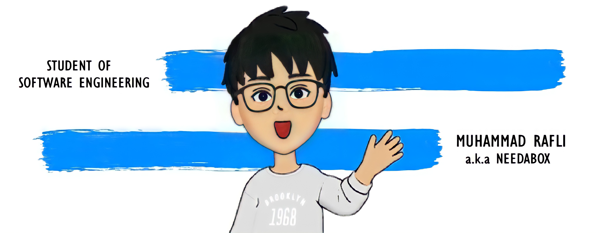

# Muhammad Rafli

Backend / Product Software Engineer from Indonesia 🇮🇩

Building scalable backend systems with Go, Laravel, PostgreSQL, Docker, and cloud-native technologies.

<a href="https://muhammad-rafli.vercel.app">Portfolio</a> •
<a href="https://linkedin.com/in/muhammad-rafli11">LinkedIn</a> •
<a href="mailto:rafli1162003@gmail.com">Email</a>

---

## 👋 About Me

I'm a Backend / Product Software Engineer with **5+ years of experience** building APIs, backend services, and business applications.

My primary focus is designing scalable systems that are reliable, maintainable, and easy to extend.

### Current Focus

- Backend Development with Go & Laravel
- REST API Design
- PostgreSQL Performance Optimization
- Distributed Systems
- Docker & CI/CD
- System Design
- Clean Architecture

---

## 🚀 Tech Stack

---

## 💼 Featured Projects

### 🎯 Loyalty Point Platform

Backend platform for reward redemption and loyalty management.

**Highlights**

- REST API
- Scheduled Jobs
- Reward Redemption
- PostgreSQL
- Redis
- Docker
- Clean Architecture

---

### 🏋️ Membership Management System

Membership platform supporting over **1,000+ active members**.

**Highlights**

- Authentication
- Booking System
- Attendance Tracking
- Payment Integration
- Admin Dashboard

---

### ⚡ Backend Migration

Migrated legacy Laravel applications into Go services for better performance and maintainability.

Highlights:

- Service Refactoring
- API Development
- Database Optimization
- Performance Improvements

---

## 📊 GitHub Statistics

---

## 🔥 GitHub Streak

---

## 📈 Contribution Graph

---

## 🛠️ Currently Exploring

- Kubernetes
- gRPC
- Event-Driven Architecture
- Distributed Systems
- Observability
- Performance Optimization

---

## 🤝 Connect With Me

---

> *"Great software is not only about writing code, but about designing systems that remain reliable as they grow."*height="45"/> </a>   
     
    

<!--       -->
 

    

## 📊 My Github Stats

   
    
  
   
  <b>Note:</b> Top languages is only a metric of the languages my public code consists of and doesn't reflect experience or skill level.

 
 

 
 

## Connect with me:

## ❤ Views and Followers

